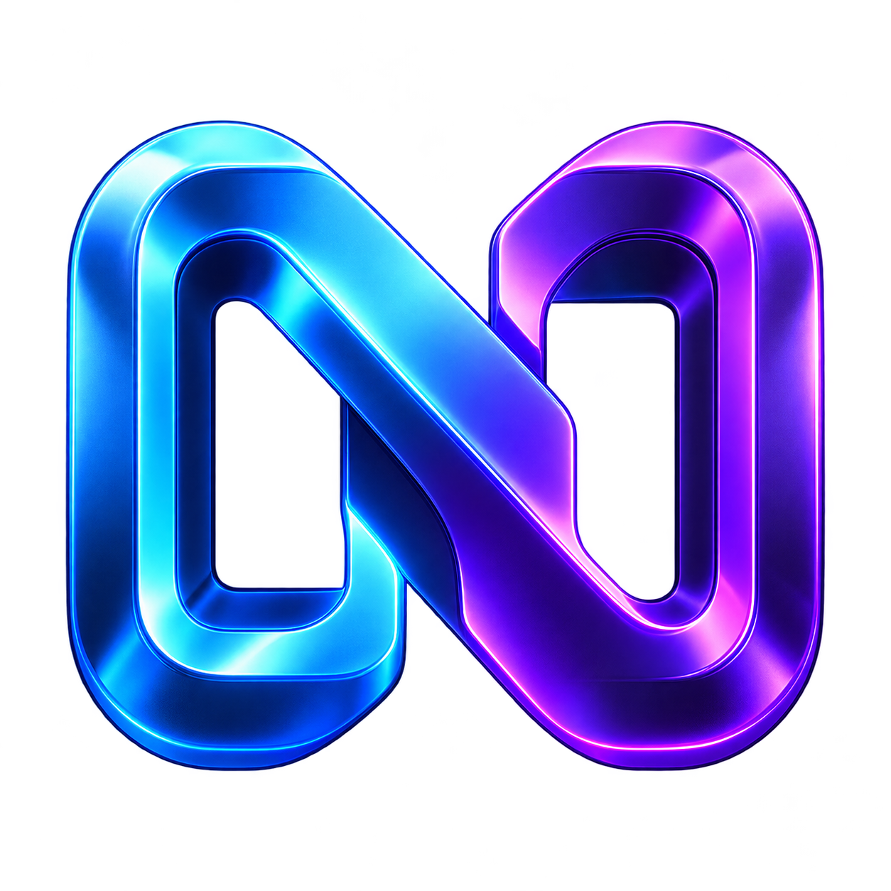

<p align="center"></p>

<h1 align="center">Noctra </h1>
<p align="center"><strong> Play PS4 On your PC.</strong><br>By Solitary</p>
<p align="center">Windows x64 · Local streaming companion · English setup guide</p>

Noctra Link is a small Windows launcher and setup companion for **chiaki-ng**. It gives you a branded entry point, a local Account-ID converter, and a practical setup guide. The original chiaki-ng client handles console registration, video, audio, and controls.

**This project does not implement a new streaming protocol or a PS4 screen-capture payload.** It uses the PS4's built-in Remote Play service. A one-time pairing is required. Console menus and games can be streamed; protected content or restricted screens may be blocked by the console.

## الشرح بالعربي

[دليل التنزيل والتثبيت والاقتران وحل المشاكل بالعربي](docs/GUIDE.ar.md)

## Download and run

Open this repository's **[Releases](https://github.com/Soiltary/Noctra/releases)** page and download **Noctra-Link-v1.0.0-Windows-x64.zip**. Extract the **entire** archive into a writable folder, then run **NoctraLink.exe**. On first use, the launcher offers a one-time verified engine download (about 97 MB). Keep the setup window open until it finishes.

1. Click **Open streaming client**.
2. Pair your PS4 in chiaki-ng on first use.
3. Select your registered console to start the stream.

Click **Setup guide** for step-by-step instructions. Do not run the executable from inside the ZIP or move it away from the `engine` and `docs` folders. Noctra Link does not require Python, administrator privileges, or a separate PowerShell launcher.

The green GitHub **Code → Download ZIP** button downloads the **source project**, which does not contain the streaming engine. Use the release archive for the complete runnable package.

## Features

- Native Windows launcher with an embedded multi-resolution application icon.
- One-time download and direct launch of the official, unmodified chiaki-ng client.
- Local conversion of a 16-digit hexadecimal Account-ID to the little-endian Base64 format used by chiaki-ng.
- Copy the converted value to the clipboard.
- Offline English HTML setup guide.
- Source code, automated conversion tests, and a Windows release workflow.

## Requirements

- Windows 10 or 11, x64.
- A PS4 with Remote Play enabled and an account that can be paired.
- PC and PS4 connected to the same local network; Ethernet is a good starting point.
- A compatible controller if you want to play through the PC.

The optional first-run engine setup downloads a pinned release from GitHub and verifies its SHA-256. After setup, the launcher opens the locally installed client. Noctra Link has no telemetry and does not collect console/account details. The independent chiaki-ng client has its own network behavior and optional PSN features. The clipboard helper only copies data when you click **Copy**.

## Local pairing and offline accounts

A local connection can use an already configured or locally activated console account without logging into PSN on the console. You still need the account's **actual Account-ID** and a fresh **Remote Play PIN**. The ID converter does not activate an account or bypass registration.

For a modified console, [Apollo Save Tool](https://github.com/bucanero/apollo-ps4#offline-account-activation) documents offline activation. Apollo is a separate project and is not bundled or automatically installed. Do not replace an existing account's ID casually: it is associated with that account's saves. Use a separate local test user when evaluating offline activation.

Do not update console firmware to use this launcher. GoldHEN and firmware-specific setup are outside the launcher's scope. No compatibility guarantee is made for a particular jailbreak or firmware combination.

## Source layout

```text
Noctra-Link/
  src/                 Native Windows launcher and embedded resources
  assets/              PNG and ICO branding assets
  docs/                English quick start, publishing notes, validation
  scripts/             Verified engine fetch and release packaging
  tests/               Account-ID conversion tests
  .github/workflows/   Windows build, tests and release packaging
  CMakeLists.txt
  LICENSE              MIT license for Noctra Link's own code
  THIRD_PARTY_NOTICES.md
```

## Build on Windows

Install Visual Studio Build Tools with **Desktop development with C++**, a Windows SDK, and CMake. From a developer terminal at the repository root:

```powershell
cmake -S . -B build -A x64
cmake --build build --config Release
ctest --test-dir build -C Release --output-on-failure
```

The launcher is produced at `build/Release/NoctraLink.exe`. Assemble a release to place it beside its guide and first-run setup script.

### Assemble the launcher release

Run from a Windows PowerShell terminal at the repository root:

```powershell
./scripts/Fetch-Engine.ps1
./scripts/Package.ps1 -Executable ./build/Release/NoctraLink.exe
```

The fetch script is optional during development; it downloads the pinned official chiaki-ng **v1.10.0** Windows x64 portable archive and verifies its SHA-256. Release packages include the setup script, not the engine binaries. End users can trigger the same download on first use. Package output goes to `dist/`.

For a local build with Zig 0.13.0, the resource compiler and `zig cc -target x86_64-windows-gnu -municode -mwindows` can also be used. The included GitHub workflow uses CMake on a Windows runner.

## Publish on GitHub

See [PUBLISHING.md](docs/PUBLISHING.md). Keep `engine/`, `build/`, and `dist/` out of Git. Commit the source and artwork, then attach the complete Windows ZIP to a GitHub Release. The workflow can also build and publish it when you push a tag such as `v1.0.0`.

## Validation and limitations

See [VALIDATION.md](docs/VALIDATION.md) for the exact checks performed on the supplied artifacts. Compilation and archive verification do not replace testing on Windows with a PS4. Latency and image quality depend on the console, client settings, and network.

## Credits and licensing

- Noctra Link launcher and its original documentation: **MIT**, by Solitary.
- Separately downloaded streaming engine: **[chiaki-ng](https://github.com/chiaki-ng/chiaki-ng)** and its contributors, under its upstream **AGPL-3.0-only with OpenSSL exception** license.
- Icon artwork: generated specifically for Noctra Link; included with the project's MIT permission to the extent applicable. See [BRANDING.md](docs/BRANDING.md).
- Original inspiration: [TheDa3/The-Screen-Mirroring](https://github.com/TheDa3/The-Screen-Mirroring), reviewed during exploration. No source code or binaries from that project are included.

Read [THIRD_PARTY_NOTICES.md](THIRD_PARTY_NOTICES.md) before redistributing the complete release. Noctra Link is an independent community project and is not affiliated with or endorsed by Sony Interactive Entertainment or the chiaki-ng maintainers. PlayStation and PS4 are trademarks of their respective owners.
